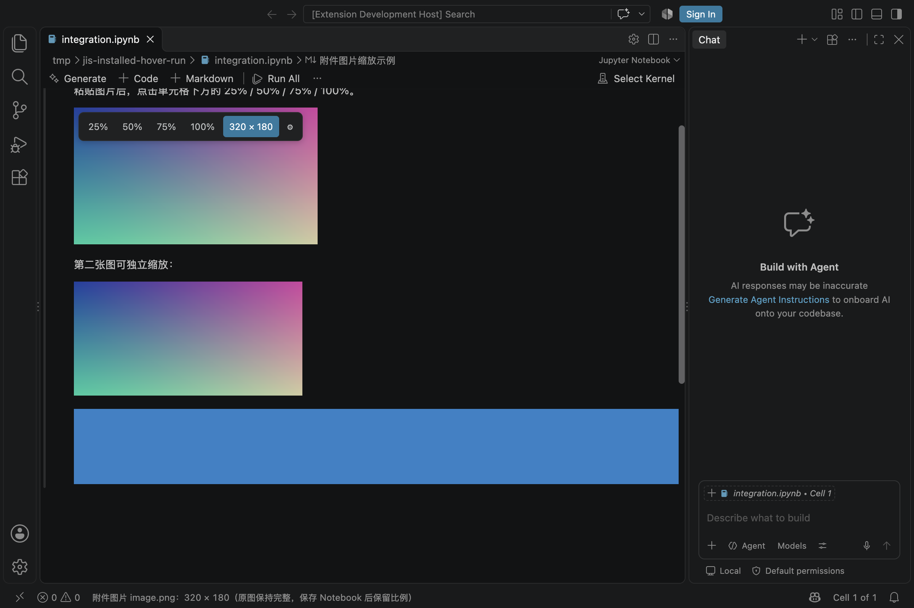

# Jupyter Image Scaler · 附件图片缩放

给 VS Code 的 `.ipynb` Markdown 附件图片提供悬浮缩放菜单：**25% / 50% / 75% / 100%**，支持自定义比例、像素尺寸和快捷档位。保留原始附件，不压缩原图。

> **按钮能打开、选比例却没有变化？** 安装或更新后，请在使用图片的那个 VS Code 窗口运行 `⌘⇧P` → **开发人员：重新加载窗口**。扩展命令可用不代表已经打开的 Notebook 加载了新图片渲染器。先保存文件，再重新加载并选择比例。

## 操作示例

运行 Markdown 单元格后，鼠标移到图片上，左上角会出现比例按钮和齿轮。直接点击即可缩放这张图，当前档位会高亮。



## 安装和使用

1. 在 VS Code 扩展面板右上角的 `…` 菜单选择 **从 VSIX 安装… / Install from VSIX…**，选择 `releases/jupyter-image-scaler-1.1.0.vsix`。
2. 如果 Notebook 已打开，执行 **Developer: Reload Window（开发人员：重新加载窗口）**，使新渲染器生效。
3. 打开 `.ipynb`，在 Markdown 单元格粘贴图片，保留原来的 `` 写法。
4. 在图片预览状态把鼠标移到图片上，点击比例按钮；齿轮可设置自定义尺寸或管理快捷档位。编辑模式下，单元格下方也显示相同档位。
5. 如果使用编辑模式按钮，点击单元格右上角的“停止编辑”查看效果（焦点在文字编辑区时也可按 Esc），再保存 Notebook，比例会随文件保留。100% 移除该附件的缩放设置，恢复默认显示。

在图片预览模式下，可以点击单元格右上角的放大镜按钮，或选中单元格后按 **⌘⌥I**（macOS）或 **Ctrl+Alt+I**（Windows / Linux），选择图片和比例；或打开命令面板搜索 **附件图片缩放**。VS Code 会在 Markdown 编辑模式显示单元格下方按钮；如果编辑时仍未显示，在设置中把 `Notebook: Show Cell Status Bar` 设为 `visible`，或直接使用快捷键。

## 自定义档位和尺寸

点击图片旁的 **⚙**：

- **添加百分比快捷档位**：输入 1–100 的整数，例如 `60`，生成 `60%` 按钮。
- **自定义尺寸：应用到这张图**：输入 `320` 表示宽 320px、高度等比；输入 `320x180` 指定宽高，可能改变原图比例。应用后可选择同时保存为快捷档位。
- **添加尺寸快捷档位**：直接保存常用尺寸，之后点击对应按钮即可应用。
- 可删除档位或恢复默认四档；最多保留 12 档。档位保存在 VS Code 用户设置 `jupyterImageScaler.presets`，所有 Notebook 共用。图片实际尺寸保存在当前 Notebook，独立于快捷按钮。

像素宽度受单元格可用宽度限制。悬浮菜单也支持 Tab 键聚焦显示。没有唯一 ID、内容又完全相同的旧单元格若无法准确定位，会提示使用该单元格右上角的放大镜。

## 比例和保存方式

- 比例以默认显示宽度为基准，即原图宽度与单元格可用宽度中的较小值。大图以铺满单元格为 100%，75% 显示为可用宽度的四分之三；小图以原图宽度为 100%。高度自动等比调整。
- 每次均以默认显示宽度计算。先选择 25% 再选 50%，结果仍是默认宽度的一半，不会连续累乘。窗口宽度改变时会自动适配。
- 100% 恢复默认显示。四档比例对大图也有区别，原图像素和附件数据均不改变。
- 比例菜单默认高亮当前比例；100% 是未设置缩放时的默认选项。
- 只修改当前单元格里选中的附件；同名附件在同一单元格内多次引用时一起变化，其他单元格不受影响。
- 图片二进制数据保持原样，仍保存在 `.ipynb` 的 `attachments` 中。显示比例写入单元格 `metadata.jupyterImageScaler`。支持 Notebook 原生撤销/重做。
- 无网络请求、无遥测、不需要 Python 内核。运行时依赖已包含在安装包中，无需安装 Node.js。

## VS Code / Jupyter 限制

**不要把附件改成 ``。** 当前 VS Code 自带的 Notebook 附件处理器只在 Markdown 图片 token 上把 `attachment:` 转换成图片数据；普通 HTML 标签不会经过这一步。这也是之前改成 HTML 后图片无法显示的原因。本扩展扩展同一个 Notebook 渲染器，在转换附件地址之前给图片加上显示宽度。

**缩放效果需要本扩展。** 在未安装扩展的另一台电脑、JupyterLab、浏览器 Notebook 或 GitHub 预览中，原图仍然嵌入文件，但这个自定义比例可能被忽略，按默认大小显示。这里交付的是 VS Code 专用的无损显示缩放，不承诺跨编辑器显示尺寸一致。导出 HTML / PDF 的尺寸由导出工具决定。

**优先保留 VS Code 粘贴生成的简单附件文件名和行内引用。** 在实测的 VS Code 1.145.2 中，内置保存清理器直接匹配 Markdown 源码中的附件名，不能可靠识别 URL 编码后的空格名称（例如附件名 `second image.png`，源码却写 `second%20image.png`），保存时可能移除该附件；引用式图片和带 title 的附件引用也存在匹配限制。本扩展不改写源码、不接管自带附件清理器。推荐 `` 这种原生粘贴写法；不要为设置比例而手动添加 title 或更换引用语法。

支持可读取尺寸的常见 PNG、JPEG、GIF、WebP、BMP、SVG 等附件；损坏或无法读取尺寸的图片会提示错误，不改动附件。当前功能仅用于 Markdown 附件，不处理代码输出图、网络图或外部文件。最低声明版本 VS Code 1.100，已在 macOS / VS Code 1.145.2 实测；其他系统和旧版未做真实窗口测试。

## 现有扩展核查（2026-11-16）

未找到经核实同时提供 ipynb 原生附件和 25% / 50% / 75% 快捷预设的现成扩展；这不代表市场上绝对不存在其他产品。

| 扩展 | 已核实功能 | 与本需求的差异 |
| --- | --- | --- |
| [JupyterNotebook Image Editor](https://marketplace.visualstudio.com/items?itemName=TDR474.drag-and-drop-images) | 插入、裁剪、自定义宽高 | 没有文档证据证明支持既有附件的百分比快捷操作；本机 1.1.0 也未发现这些预设 |
| [MiConvert Image Tools](https://marketplace.visualstudio.com/items?itemName=MiConvert.miconvert-image-tools) | 25%、50%、75% 图片文件缩放 | 文档指向文件/目录处理，没有证据支持 Notebook 内部 attachments |
| [Markdown Image Resize Viewer](https://marketplace.visualstudio.com/items?itemName=MetroSoft-Application.markdown-image-resize-viewer) | `.md` 自定义编辑器拖动缩放 | 不是 ipynb Markdown 单元格的原生附件缩放 |
| [Markdown Imsize Support](https://marketplace.visualstudio.com/items?itemName=amoosbr.markdown-imsize) | 普通 Markdown 预览中的图片尺寸语法 | 需手写语法，未证明支持 Notebook 附件与快捷预设 |

实现参考：[VS Code Notebook API](https://code.visualstudio.com/api/extension-guides/notebook)、[NotebookEdit API](https://code.visualstudio.com/api/references/vscode-api#NotebookEdit)。附件处理与保存限制还核对了本机 VS Code 内置 `ipynb` 扩展的 `cellAttachmentRenderer.js` 与 `ipynbMain.node.js`。

## 源码构建和测试

```sh
npm ci
npm run build
npm test
npm run package
```

源码包提供单元测试、真实 VS Code 扩展宿主测试和 Notebook 页面交互测试。`test/integration.cjs` 可通过 VS Code 的 `--extensionDevelopmentPath` / `--extensionTestsPath` 运行；`test/browser.cjs` 检查旧版命令交互，`test/hover.cjs` 检查悬浮按钮、自定义档位、尺寸和同名图片定位，可通过 `JIS_RUN` 与 `JIS_CDP` 指定独立测试目录及本机调试端口。只在单独测试窗口启用该端口，完成后退出窗口。

许可证：MIT。安装包为本地开发版，未发布到 Marketplace，也未通过 Marketplace 签名。


## 项目目录

- `src/`：扩展命令、缩放逻辑与 Notebook 渲染器
- `test/`：单元、扩展宿主与界面测试；`results/` 保存历史测试结果
- `examples/`：可直接打开的示例 Notebook
- `docs/`：测试记录与效果截图
- `releases/`：可安装的 VSIX
- `archive/`：本地保留的原始交付压缩包与重复说明，不提交 Git
- `dist/`、`node_modules/`：构建产物与依赖，不提交 Git

源码开发：`npm ci`，然后运行 `npm test`、`npm run build`；打包使用 `npm run package`。
