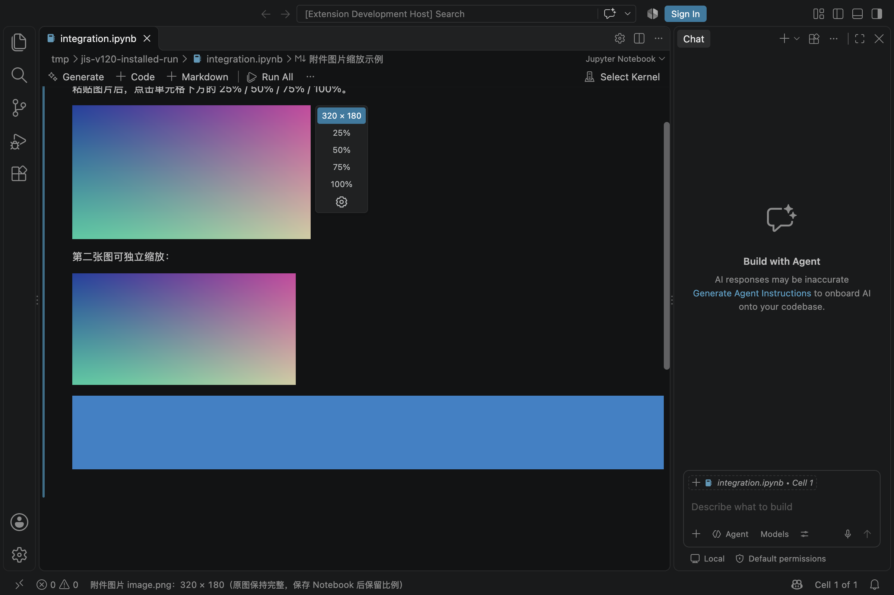

# Jupyter Image Scaler · 附件图片缩放

[English](https://github.com/CurtisYan/jupyter-image-scaler/blob/main/README.md) | 简体中文

为 VS Code Jupyter Notebook 的 Markdown 附件图片提供紧凑悬浮菜单：**25% / 50% / 75% / 100%**，支持自定义比例、像素尺寸与快捷档位。保留原始附件，不压缩原图。

> 扩展界面目前为中文。安装或更新后，请先保存 Notebook，再在使用它的 VS Code 窗口执行 **Developer: Reload Window（开发人员：重新加载窗口）**。已打开的 Notebook 可能仍在使用旧版图片渲染器，出现按钮可点但缩放不生效的情况。

## 操作示例

运行 Markdown 单元格后，鼠标移到图片上即可显示快捷档位，当前档位会高亮。齿轮可管理档位，或切换到图片外部自动避让的菜单样式。



## 安装和使用

1. 从 [GitHub Releases](https://github.com/CurtisYan/jupyter-image-scaler/releases/latest) 下载 `jupyter-image-scaler-1.2.0.vsix`。
2. 在 VS Code 扩展面板右上角 **…** 菜单选择 **从 VSIX 安装… / Install from VSIX…**，选择下载的文件。
3. 保存文件，从命令面板执行 **开发人员：重新加载窗口 / Developer: Reload Window**。
4. 打开 `.ipynb`，在 Markdown 单元格中粘贴图片，保留原生附件语法：``。
5. 渲染单元格后，把鼠标移到图片上并点击档位；保存 Notebook 即可保留显示尺寸。**100%** 恢复默认显示。

编辑状态下也可使用单元格下方的档位按钮；或点击单元格工具栏的放大镜，使用 **⌘⌥I**（macOS）/ **Ctrl+Alt+I**（Windows、Linux），也可在命令面板搜索 **附件图片缩放**。编辑时按钮若未显示，请把 **Notebook: Show Cell Status Bar** 设为 `visible`。

可直接打开 [示例 Notebook](https://github.com/CurtisYan/jupyter-image-scaler/blob/main/examples/附件图片缩放示例.ipynb) 体验。

## 自定义档位和菜单

点击图片旁的 **齿轮**：

- **添加百分比快捷档位**：输入 1–100 的整数，例如 `60`，生成 `60%` 按钮。
- **自定义尺寸**：输入 `320` 表示宽 320px、高度等比；输入 `320x180` 指定宽高，可能改变原图比例。应用到当前图片后可选择同时保存为档位，也可直接添加尺寸快捷档位。
- **调整档位顺序**：上移、下移、移到最前或最后；每次移动立即保存，并同步到编辑模式按钮。
- **切换菜单样式**：选择左上角悬浮，或 **图片外部（自动避让）**。外部菜单自动选择图片两侧空位，两侧放不下时在下方预留空间，保持图片尺寸，并避免遮挡后续内容。
- **管理档位**：可删除或恢复默认四档，最多保留 12 档。

档位及顺序保存在用户设置 `jupyterImageScaler.presets`，菜单样式保存在 `jupyterImageScaler.toolbarStyle`，所有 Notebook 共用。每张图片实际应用的尺寸单独保存在当前 Notebook 中。菜单也支持通过 Tab 键聚焦显示。

## 比例和保存方式

- 百分比以 **默认显示宽度** 为基准，即原图宽度与单元格可用宽度中的较小值。大图的 75% 占可用宽度的四分之三，小图的 100% 保持原图宽度。
- 每次从默认宽度计算。先选 25% 再选 50%，结果仍为默认宽度的一半。百分比随窗口宽度适配；像素宽度也受单元格可用宽度限制。
- 只修改当前单元格中选中的附件；同一附件在该单元格内多次引用时共享尺寸，其他单元格不受影响。无法唯一定位的旧单元格可使用其右上角的放大镜操作。
- 原始字节保留在 `.ipynb` 的 `attachments` 中，显示尺寸写入 `metadata.jupyterImageScaler`，支持 Notebook 原生撤销、重做和保存。
- 无网络请求、无遥测，不需要 Python 内核。运行时依赖已打包，安装扩展无需 Node.js。

## 兼容性与更新

要求 **VS Code 1.100.0 或以上**；已在 **macOS / VS Code 1.145.2** 真实窗口中测试，其他系统及旧版本尚未做真实窗口测试。目前仅支持 Markdown **附件图片**，不处理代码输出图、网络图和外部文件。

请保留上述简单原生附件语法，不要改为 ``：VS Code 附件渲染器通过 Markdown 图片 token 解析附件地址。优先使用原生粘贴生成的文件名；URL 编码名称、引用式图片及带 title 的语法可能遇到 VS Code 保存时清理附件的限制。本扩展不改写源码，也不接管附件清理。

显示自定义尺寸需要本扩展。JupyterLab、GitHub 预览、其他编辑器及导出工具可能忽略尺寸元数据，原图仍嵌入文件。损坏或无法读取尺寸的图片会提示错误，不改动附件。

**更新方式：** 当前通过 GitHub Release 分发 VSIX，尚未发布到 Visual Studio Marketplace。VS Code 的自动更新检查扩展市场，不检查 GitHub 标签或 Release。更新时下载新版 VSIX 安装，再重新加载窗口。参见 [VS Code 官方扩展文档](https://code.visualstudio.com/docs/configure/extensions/extension-marketplace#extension-auto-update)。

## 源码开发

```sh
npm ci
npm test
npm run build
npm run package -- --out releases/jupyter-image-scaler-1.2.0.vsix
```

- `src/`：扩展命令、图片元数据逻辑和 Notebook 渲染器。
- `test/`：单元、扩展宿主及界面测试；`test/results/` 保存测试结果。
- `examples/`：示例 Notebook。
- `docs/`：截图、测试记录和 [早期扩展核查](https://github.com/CurtisYan/jupyter-image-scaler/blob/main/docs/extension-research.zh-CN.md)。
- `releases/`：可安装的 VSIX；`dist/`、`node_modules/` 为本地生成内容。

1.2.0 已通过 8 项单元测试、9 项扩展宿主检查和 16 项安装包界面检查，详见 [测试记录](https://github.com/CurtisYan/jupyter-image-scaler/blob/main/docs/v1.2.0-测试记录.md)。`test/integration.cjs` 通过 VS Code 的 `--extensionDevelopmentPath` / `--extensionTestsPath` 运行，`test/hover.cjs` 验证悬浮交互；通过 `JIS_RUN`、`JIS_CDP` 指定独立测试目录和本机调试端口，完成后退出测试窗口。

[MIT 许可证](https://github.com/CurtisYan/jupyter-image-scaler/blob/main/LICENSE)。
